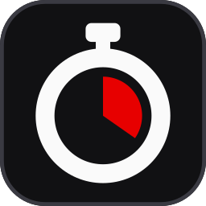
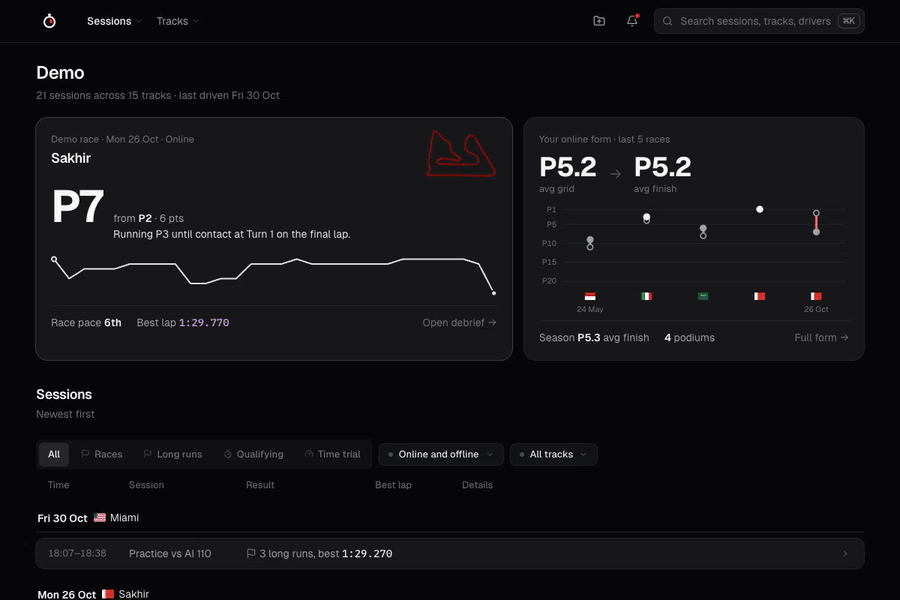

<p align="center">
  
</p>

<h1 align="center">F1 Telemetry Viewer</h1>

<p align="center">
  Race debriefs, lap comparisons, stint analysis and tyre strategy for your F1 game sessions.<br>
  A private, local-first viewer for <a href="https://github.com/ashwin-nat/pits-n-giggles">Pits n' Giggles</a> telemetry.
</p>

<p align="center">
  <a href="https://f1-telemetry-viewer.vercel.app"><strong>Try the live demo</strong></a>
  &nbsp;·&nbsp;
  <a href="#quick-start"><strong>Run it on your data</strong></a>
</p>

<p align="center">
  
</p>

> [!NOTE]
> Created by [Fabrizio Rinaldi](https://fabrizio.so) ([@linuz90](https://x.com/linuz90)). Built for the [Pits n' Giggles](https://www.pitsngiggles.com/) telemetry format and now integrated into Pits n' Giggles itself, thanks to the kind help of its founder.

## What It Does

Supports recent F1 and F2 telemetry, including the **2026 Season Pack**.

- 🏠 **Sessions home.** Your latest race and online form on top, then every session grouped by day, track and online event, with ⌘K search across tracks, sessions and drivers.
- 🏁 **Race debriefs.** Each race, long run, qualifying session or time trial opens on a headline of what happened and a ranked "Worth a look" list, with tabs for laps, tyres, lap telemetry, results and the car setup. Pit cycles and back-and-forth swaps are netted out, so a gained place is a real one.
- 🛞 **Stint comparison.** A long run, and each race stint, sits beside your earlier runs on the same tyre at that track: laps paired by tyre age on equal fuel, with wear, fade and setup changes next to the pace.
- 📈 **Lap telemetry.** With Pits n' Giggles 5.0 lap recordings, compare two laps on speed, throttle, brake, gear and battery, with a track map, playback and tips on where the time went, labelled by turn. Compare with a rival, the session best, your own best, or a friend's `.pngt` dropped onto the page.
- 🗺️ **Track pages.** A circuit map with the timing line, sectors and turn numbers, then your PBs, qualifying progress, a race plan with tyre life and fuel, your setups, and every saved session there.
- 📉 **Online form.** Grid against finish, race by race, with podiums, front-row starts and DNFs.
- 🧭 **Formula scopes.** F1 26, F1 25, F2 25 and older data stay separate, with clean URLs such as `/f1-26/tracks/sakhir`.
- 🔒 **Private by design.** No account and no database. Your telemetry stays on your machine, and files dragged into the hosted app never leave your browser.

## Three Ways To Use It

| Mode                                                  | Best for                                | How it works                                                                   |
| ----------------------------------------------------- | --------------------------------------- | ------------------------------------------------------------------------------ |
| [Hosted demo](https://f1-telemetry-viewer.vercel.app) | Trying it, or a quick look at your data | Sample data loads first; drag in `.json`, `.pngt` or `.zip` files to see yours |
| Local                                                 | Your full telemetry folder              | Set `TELEMETRY_DIR` and run `pnpm dev`                                         |
| Self-hosted                                           | An always-on machine or NAS             | Build once, then `pnpm start` serves the app and the telemetry API             |

It also ships inside Pits n' Giggles as its save viewer.

## Quick Start

You need Node 22.12 or newer and [pnpm](https://pnpm.io).

```bash
pnpm install
cp .env.example .env
```

Point `.env` at your telemetry folder:

```bash
TELEMETRY_DIR=/path/to/your/telemetry/files
```

Then start the app and open the URL it prints, usually [http://localhost:5173](http://localhost:5173):

```bash
pnpm dev
```

The folder is scanned recursively, so your normal Pits n' Giggles layout can stay as it is. Filenames follow the Pits n' Giggles pattern:

```txt
SessionType_Track_YYYY_MM_DD_HH_mm_ss.json
```

Lap recordings (`.pngt`) anywhere under the folder pair with their session automatically.

## Supported Data

- Race, qualifying, time trial, practice and other Pits n' Giggles session JSON files
- Pits n' Giggles 5.0 beta lap recordings (`.pngt`) for lap traces and comparisons
- F1 26 and the 2026 Season Pack, F1 25, F2 25 and older F1 generations, with Madring in the F1 26 calendar
- Online race rosters when available: rivals, teams, grid and finish, penalties, DNFs and fastest laps
- Older exports with fewer fields; the UI shows what it can work out from them

## Self-Hosting

Build once, then run the lightweight production server against your telemetry folder:

```bash
pnpm build
TELEMETRY_DIR=/path/to/your/telemetry pnpm start
```

This serves the app at [http://localhost:3080](http://localhost:3080) on macOS, Linux or Windows, with HTTP caching and compression and none of Vite's dev tooling.

| Variable        | Default               | Description                                        |
| --------------- | --------------------- | -------------------------------------------------- |
| `TELEMETRY_DIR` | _(required)_          | Path to your Pits n' Giggles telemetry folder      |
| `PORT`          | `3080`                | HTTP port for the production server                |
| `DIST_DIR`      | `./dist`              | Path to the built frontend                         |
| `VITE_APP_NAME` | `F1 Telemetry Viewer` | Optional product-name override for embedded builds |

The viewer keeps a derived summary index in `.cache/f1-telemetry-viewer/`, in the folder it starts from. The first start reads every file once; after that it only reads what changed. The index can hold driver and rival names, so it gets private file permissions where the system supports them. It never contains full telemetry, it never writes to your telemetry folder, and it's safe to delete while the viewer is stopped.

### Embedding

Pits n' Giggles bundles the viewer under `/save-viewer/` and serves its own session API. A host sets these at build time:

| Variable                      | Pits n' Giggles   | Effect                                                                        |
| ----------------------------- | ----------------- | ----------------------------------------------------------------------------- |
| `VITE_BASE_PATH`              | `/save-viewer/`   | Base path for assets, API calls and routes                                    |
| `VITE_APP_NAME`               | `Pits n' Giggles` | Product name in labels and the upload screen                                  |
| `VITE_THEME`                  | `dark`            | Forces `dark` or `light` instead of the system setting (`?theme=` still wins) |
| `VITE_EXTERNAL_LINK_TEMPLATE` | `/legacy/{slug}`  | Link from every session page to the host's view of the same save              |
| `VITE_EXTERNAL_LINK_LABEL`    | `Legacy View`     | Label for that link                                                           |
| `VITE_DISABLE_ANALYTICS`      | `true`            | Turns off Vercel Analytics                                                    |

At serve time it can set `window.__PNG_VERSION__` (page title) and `window.__PNG_SAVE_VIEWER_CONFIG__ = { sessionPollIntervalMs }` (session-list refresh, `null` to disable). Its `index.html` rewrites rely on the favicon and touch-icon links staying as they are. A session list without `isAutoSave` is deduplicated in the browser.

## Development

```bash
pnpm dev                     # Dev server against TELEMETRY_DIR
pnpm dev:telemetry <folder>  # Dev server against one folder, for repro files
pnpm dev:prod                # Demo and upload mode, without the local API
pnpm build                   # Type-check and build
pnpm test                    # All focused test suites
pnpm test:<suite>            # One suite; package.json lists them
pnpm generate-demo           # Rebuild public/demo/ from real sessions
pnpm find-session <slug>     # Resolve a session URL or slug to its JSON file
```

`pnpm build` is the main whole-app check. The telemetry logic has focused suites on Node's test runner; there's no UI test runner or linter. `package.json` has the rest of the commands, and [AGENTS.md](AGENTS.md) records the telemetry rules behind the numbers.

`pnpm generate-demo` swaps every human name for a fictional handle and fails if a real one survives, so nothing in `public/demo/` identifies a real player.

### Architecture

React 19, TypeScript, Vite 8, Tailwind CSS 4, Base UI, Recharts 3, React Router 7, TanStack Query 5, JSZip, Motion and lucide-react.

```txt
src/
  analysis/    Page models: race story, Worth a look, stint comparison, lap tips, strategy
  components/  App shell, shared charts, session and track parts, Base UI wrappers
  context/     TelemetryProvider, lap imports, browser zip and JSON loading
  hooks/       Session lists, track history, lap recordings, stint comparison
  pages/       Sessions home, session views, tracks, track page, online form
  plugin/      Session and lap-recording indexes, the local telemetry API
  queries/     TanStack Query definitions for sessions and recordings
  utils/       Formatting, track identity, recording reader, low-level stats
```

Every screen uses one data path: the local telemetry API, then the bundled demo, then browser uploads. The local dev server and `pnpm start` share one incremental index, so `/api/sessions` stays fast and keeps the shape Pits n' Giggles serves.

The game generation is part of the route (`/:formulaKey`), so the session log, PBs, tyre life and setups always describe one generation.

Telemetry calculations sit in two layers. `src/utils/stats/` holds small primitives such as lap filtering and tyre wear; `src/analysis/` holds product models and policies. Components render those models rather than reimplementing telemetry rules.

## License

[MIT](LICENSE)
